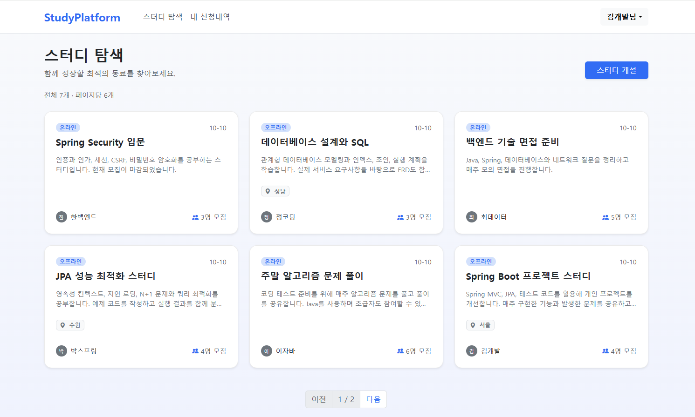
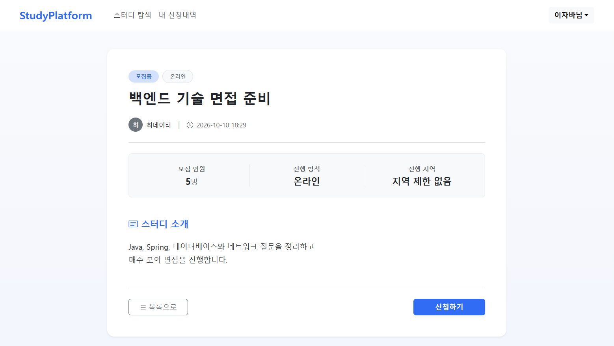
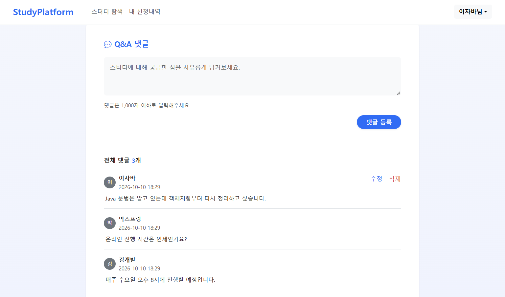
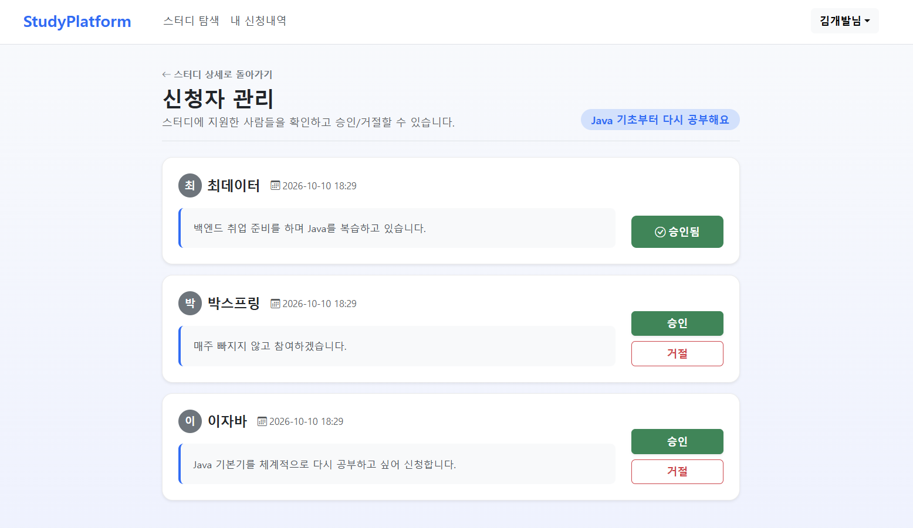
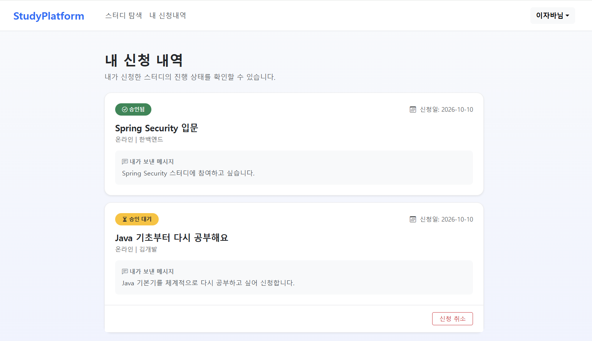

# 📚 Study Community Platform

[](https://github.com/ldhan0115/study-community-platform/actions/workflows/ci.yml)

> 스터디 모집부터 참가 신청, 승인·거절, 댓글 관리까지 제공하는 Spring MVC 기반 커뮤니티 웹 애플리케이션

회원은 스터디를 개설하거나 다른 회원의 스터디에 참가를 신청할 수 있습니다. 방장은 신청자를 승인하거나 거절하며, 승인 인원이 정원에 도달하면 모집이 자동으로 마감됩니다.

Spring Security 기반 인증·인가, 도메인 상태 전이, MySQL 동시성 제어, 조회 범위 제한과 실행 환경 재현에 집중했습니다.

| 구분 | 내용 |
| --- | --- |
| 개발 기간 | 2026.02.13 ~ 진행 중 |
| 개발 인원 | 1명 |
| 개발 형태 | 개인 프로젝트 |
| 주요 관심사 | 인증·인가, 데이터 정합성, 트랜잭션, JPA, 테스트 |

## 핵심 구현

### 1. Spring Security 인증과 서버 측 권한 검증

- 로그인 요청은 Spring Security 인증 필터가 처리합니다.
- `CustomUserDetailsService`는 활성 회원의 인증 정보를 조회하며, 비밀번호 검증은 Spring Security와 `PasswordEncoder`가 수행합니다.
- 인증 정보는 `SecurityContext`에서 관리하고, 화면용 세션 속성에는 `LoginMemberSession(id, nickname)`을 저장합니다.
- CSRF 검증과 로그인 성공 시 세션 ID 변경을 적용했습니다.
- 스터디·신청·댓글 변경 권한은 서비스에서 실제 리소스 소유자를 기준으로 검사합니다.
- 회원정보 수정 성공 시 현재 세션을 정리하고 재로그인을 요구합니다.
- 탈퇴 회원의 기존 인증 세션은 다음 요청에서 `ActiveMemberFilter`가 정리합니다.

### 2. 입력 검증과 실패 시 데이터 보존

- 회원·스터디·신청·댓글 폼에 Bean Validation을 적용했습니다.
- 스터디·신청·댓글의 도메인 메서드에서도 필수 입력과 길이를 검증합니다.
- 회원 중복 입력은 사전 조회와 DB UNIQUE 제약 충돌 처리를 통해 안내합니다.
- 신청·댓글 입력 오류는 Flash 속성으로 메시지와 입력값을 전달합니다.
- 댓글 수정 검증에 실패하면 기존 내용을 유지합니다.

### 3. 신청 상태와 모집 정원 관리

- 새 신청은 `PENDING` 상태로 생성됩니다.
- `PENDING`에서만 승인·거절·취소할 수 있습니다.
- `PENDING` 또는 `APPROVED` 신청이 있으면 같은 스터디에 추가 신청할 수 없습니다.
- 취소·거절 후에는 기존 이력을 보존하고 새로운 신청을 생성합니다.
- 방장은 자신의 스터디에 신청할 수 없습니다.
- 모집 정원은 방장을 제외한 승인 인원을 기준으로 계산합니다.
- 승인 인원이 정원에 도달하면 `CLOSED`로 전환합니다.
- 승인 인원보다 작은 정원으로 수정할 수 없으며, 정원을 늘려 여유가 생기면 `OPEN`으로 전환합니다.

### 4. MySQL 동시성 제어

- 같은 스터디의 신청·승인·거절·취소·정원 변경·삭제에서 공통으로 Study 행의 비관적 쓰기 잠금을 사용합니다.
- 변경 서비스에 `READ_COMMITTED`를 적용하고 잠금 획득 후 중복 신청·승인 인원·신청 상태를 검사합니다.
- 신청 변경은 부모 스터디의 잠금을 획득한 뒤 신청 엔티티를 조회합니다.
- MySQL 테스트는 별도 스레드에서 서비스 트랜잭션을 실행하고, 작업 종료 후 DB를 다시 조회하도록 구성했습니다.
- 잠금 획득 실패는 전역 예외 처리에서 HTTP 409로 안내합니다.

### 5. 논리적 삭제와 활성 리소스 검사

- 회원·스터디·댓글은 `deletedAt`을 기록해 이력을 보존합니다.
- 탈퇴한 계정의 로그인 ID·이메일·닉네임은 재사용하지 않습니다.
- 삭제된 스터디와 댓글은 일반 엔티티 조회에서 제외합니다.
- 삭제된 스터디에 연결된 신청은 내 신청내역에서 제외합니다.
- 댓글 변경 시 작성자, 실제 소속 스터디, 부모 스터디의 활성 상태를 확인합니다.
- 변경 서비스에서 요청 회원의 활성 상태를 검사합니다.

### 6. 조회 범위와 연관 데이터 로딩

- 화면에서 사용하는 작성자·신청자·스터디 정보를 fetch join으로 함께 조회합니다.
- 중복 신청 검사는 상태 조건을 포함한 존재 여부 조회를 사용합니다.
- 스터디 목록은 기본 10개, 최대 50개 단위로 조회합니다.
- `createdAt DESC, id DESC` 정렬로 생성 시각이 같은 데이터의 순서도 결정합니다.
- MySQL 테스트에서 SQL 수와 엔티티 로딩 수를 확인합니다.
- 기존 측정 로그에서 전후 수치 감소는 확인되지 않았으며, 응답 시간 개선율은 주장하지 않습니다.

### 7. 실행 환경과 CI

- Docker Compose로 개발 DB와 테스트 DB를 분리했습니다.
- MySQL 스키마는 Flyway V1·V2 마이그레이션으로 관리합니다.
- Hibernate의 `ddl-auto: validate`로 엔티티와 스키마의 매핑을 확인합니다.
- Dockerfile에서 Java 21로 JAR를 빌드하고 실행 이미지를 구성합니다.
- GitHub Actions에서 H2 테스트, MySQL 테스트, Docker 앱 시작과 공개 페이지 응답을 검사합니다.
- 공통 메뉴에 모바일 토글과 클릭 방식의 회원 메뉴를 적용했습니다.

## 문제 해결 사례

| 주제 | 핵심 내용 |
| --- | --- |
| [신청 권한 검증](./docs/troubleshooting/prevent-api-authorization-bypass.md) | 실제 신청·스터디 연관관계를 기준으로 서비스에서 인가 |
| [동시 신청·승인과 정원 보호](./docs/troubleshooting/application-concurrency.md) | 공통 Study 행 잠금, 트랜잭션 범위, 최종 DB 상태 검증 |
| [조회 측정과 페이지네이션](./docs/troubleshooting/query-measurement.md) | SQL·엔티티 로딩 측정, 실행 계획 해석, 측정 범위와 한계 |

기존 문제 해결 기록은 [트러블슈팅 디렉터리](./docs/troubleshooting)에서 확인할 수 있습니다.

## 주요 화면

### 스터디 목록

페이지 단위로 스터디를 조회하고 진행 방식·지역·모집 상태를 확인합니다.



### 스터디 상세

스터디 소개와 모집 상태를 확인하고 참가를 신청합니다.



### 댓글

댓글을 등록하고 작성자 본인의 댓글을 수정·삭제합니다.



### 신청자 관리

방장이 대기 중인 신청을 승인하거나 거절합니다.



### 내 신청내역

신청 상태를 확인하고 대기 중인 신청을 취소합니다.



## 도메인 규칙

| 현재 신청 상태 | 허용되는 다음 상태 |
| --- | --- |
| `PENDING` | `APPROVED`, `REJECTED`, `CANCELED` |
| `APPROVED`, `REJECTED`, `CANCELED` | 변경 불가 |

| 입력 항목 | 규칙 |
| --- | --- |
| 로그인 ID | 필수, 4~20자 |
| 비밀번호 | 필수, 8~20자 |
| 이메일 | 필수, 이메일 형식, 최대 100자 |
| 닉네임 | 필수, 2~20자 |
| 스터디 제목 | 필수, 최대 255자 |
| 스터디 본문 | 필수, 최대 10,000자 |
| 진행 방식·지역 | 진행 방식 필수, 지역 최대 50자, 오프라인 지역 필수, 온라인 지역 NULL 저장 |
| 모집 정원 | 1명 이상, 수정 시 현재 승인 인원 이상 |
| 신청 메시지 | 필수, 최대 255자 |
| 댓글 | 필수, 최대 1,000자 |

필수 문자열은 빈 값과 공백만 입력한 값도 거부합니다. 애플리케이션의 입력 규칙과 DB 제약은 [물리 모델](./docs/04-physical-model.md)에 구분해 정리했습니다.

## 오류 처리

| 예외 | 전역 처리 시 HTTP 상태 |
| --- | --- |
| `BusinessRuleException` | 400 |
| `ForbiddenOperationException` | 403 |
| `ResourceNotFoundException` | 404 |
| `PessimisticLockingFailureException` | 409 |

폼 검증·회원 중복 오류와 일부 참가 신청 오류는 컨트롤러에서 입력 화면 또는 Flash 메시지로 안내합니다.

## 기술 스택

| 구분 | 기술 |
| --- | --- |
| Language | Java 21 |
| Framework | Spring Boot 4.0.3, Spring MVC |
| Security | Spring Security, HttpSession, PasswordEncoder |
| Data Access | Spring Data JPA, Hibernate |
| Database | MySQL 8.4, 테스트용 H2 |
| Schema Migration | Flyway |
| View | Thymeleaf, Bootstrap 5 |
| Validation | Jakarta Bean Validation |
| Test | JUnit Jupiter, AssertJ, MockMvc, Spring Security Test |
| Build | Gradle Wrapper 9.3.1 |
| Container / CI | Docker, Docker Compose, GitHub Actions |

## 실행 방법

모든 명령은 `build.gradle`과 `compose.yml`이 있는 프로젝트 최상위에서 실행합니다.

### 저장소 복제

```bash
git clone https://github.com/ldhan0115/study-community-platform.git
cd study-community-platform
```

### 방법 A: 앱과 DB를 Docker로 실행

Docker Desktop 또는 Docker Engine과 Compose가 필요합니다. Java 빌드는 Dockerfile 내부에서 수행합니다.

```bash
docker compose --profile app build app
docker compose --profile app up -d --wait --wait-timeout 240 app
```

접속: [http://localhost:8081/studies](http://localhost:8081/studies)

로그 확인:

```bash
docker compose --profile app logs --tail=100 app
```

현재 Compose 앱은 `prod` 프로필을 사용하며 샘플 데이터를 자동 생성하지 않습니다. 회원가입 후 기능을 사용할 수 있습니다.

### 방법 B: Java 21에서 앱을 직접 실행

Java 21과 실행 중인 Docker 환경이 필요합니다.

아래 Gradle 명령은 Windows Git Bash 기준입니다. macOS·Linux에서는 `./gradlew.bat` 대신 `bash ./gradlew`를 사용합니다.

```bash
docker compose up -d --wait --wait-timeout 180 mysql
./gradlew.bat bootRun --args="--spring.profiles.active=local"
```

접속: [http://localhost:8080/studies](http://localhost:8080/studies)

화면 확인 시에는 두 실행 방법 중 하나를 선택합니다.

### 샘플 데이터

빈 개발 DB에서 샘플 데이터가 필요하면 일반 실행 대신 다음 옵션으로 시작합니다.

```bash
    ./gradlew.bat bootRun --args="--spring.profiles.active=local --app.seed.enabled=true"
```

`TestDataInit`은 local 프로필, 생성 옵션 활성화, 회원 테이블이 비어 있는 조건에서만 실행됩니다. 기존 데이터가 있으면 자동 초기화하거나 덮어쓰지 않습니다.

| 역할 | 로그인 ID | 비밀번호 |
| --- | --- | --- |
| 방장 화면 확인 | `test1` | `test1234` |
| 참가 회원 화면 확인 | `test2` | `test1234` |

이 계정은 샘플 데이터를 생성했을 때 사용할 수 있습니다.

### 실행 환경

| 용도 | DB 연결 | 앱 접속 |
| --- | --- | --- |
| 호스트에서 앱 실행 | `localhost:3307/study_platform` | `localhost:8080` |
| Docker 앱 실행 | Compose 네트워크의 `mysql:3306/study_platform` | `localhost:8081` |
| MySQL 테스트 | `localhost:3308/study_platform_test` | 테스트에서 실행 |
| 기본 테스트 | 인메모리 H2 | 테스트에서 실행 |

Compose의 DB 계정은 로컬 개발용 예시입니다. 운영용 설정은 `DB_URL`, `DB_USERNAME`, `DB_PASSWORD`를 사용합니다.

## 테스트

Java 21이 필요합니다. MySQL 테스트에는 Docker의 전용 테스트 DB도 필요합니다.

### 전체 테스트

```bash
docker compose --profile test up -d --wait --wait-timeout 180 mysql-test
./gradlew.bat clean test mysqlTest
```

### 기본 H2 테스트만 실행

```bash
./gradlew.bat test
```

### MySQL 동시성 테스트만 실행

```bash
./gradlew.bat mysqlConcurrencyTest
```

`mysqlConcurrencyTest` 실행 전에도 위의 `mysql-test` DB 준비가 필요합니다. 동시성 테스트는 `mysqlTest`에도 포함됩니다.

| 영역 | 테스트 내용 |
| --- | --- |
| 인증·HTTP | 공개·보호 URL, 실제 로그인 세션, 세션 ID 변경, 로그아웃, CSRF |
| 입력·회원 | 입력 경계, 중복 정보, 수정 실패 후 DB·인증 상태 유지 |
| 권한·삭제 | 타인 리소스 변경, 탈퇴 회원 세션, 삭제된 부모·댓글 접근 |
| 상태·정원 | 허용·금지 전이, 재신청, 정원 수정, 자동 마감·재모집 |
| MySQL 저장 | Flyway, 매핑 검증, 한글·이모지·Enum, UNIQUE·FK |
| 동시성 | 동시 승인·중복 신청·상태 경합·정원 변경·잠금 실패 |
| 조회·페이징 | SQL·엔티티 로딩, 조회 범위, 정렬, 페이지 경계 |

테스트 보고서:

- `build/reports/tests/test/index.html`
- `build/reports/tests/mysqlTest/index.html`
- `build/reports/tests/mysqlConcurrencyTest/index.html` — 해당 작업을 별도로 실행한 경우

MySQL 통합 테스트는 전용 테스트 DB의 애플리케이션 데이터를 정리합니다. 개발 DB와 분리된 설정을 사용합니다.

## CI

[GitHub Actions 실행 결과](https://github.com/ldhan0115/study-community-platform/actions/workflows/ci.yml)

`main` 대상 PR과 `main` push에서 다음 작업을 실행합니다.

1. `H2 tests`: 기본 테스트
2. `MySQL tests`: 전용 MySQL의 저장·동시성·조회 테스트
3. `Docker startup`: 앞선 테스트 성공 후 이미지 빌드, 앱 시작, 공개 목록의 HTTP 200 확인

테스트 보고서와 Docker 실행 로그는 Actions 아티팩트로 보관합니다.

## 설계와 스키마

- [요구사항](./docs/01-requirements.md)
- [개념적 데이터 모델](./docs/02-conceptual-model.md)
- [논리적 데이터 모델과 관계 ERD](./docs/03-logical-model.md)
- [물리적 데이터 모델](./docs/04-physical-model.md)
- [V1 초기 스키마](./src/main/resources/db/migration/mysql/V1__initial_schema.sql)
- [V2 신청 조회 인덱스](./src/main/resources/db/migration/mysql/V2__add_application_lookup_indexes.sql)

MySQL 테이블 생성·변경은 Flyway가 담당하며 Hibernate는 매핑을 검증합니다. 기본 H2 테스트는 Flyway를 비활성화하고 `create-drop`을 사용합니다.

적용된 마이그레이션 파일은 유지하고 이후 변경은 새로운 버전으로 추가합니다.

## 현재 범위와 향후 개선

- 클라우드 공개 배포, HTTPS 및 운영 모니터링 구성
- 스터디 검색·필터 조건 추가
- 실제 부하 환경의 응답 시간과 잠금 대기 측정
- 데이터 규모에 따른 인덱스 선택·효과 추가 검증

현재 Docker Compose는 로컬 실행 환경입니다. CI에는 테스트와 앱 시작 확인이 포함되어 있으며 클라우드 자동 배포는 포함하지 않습니다.